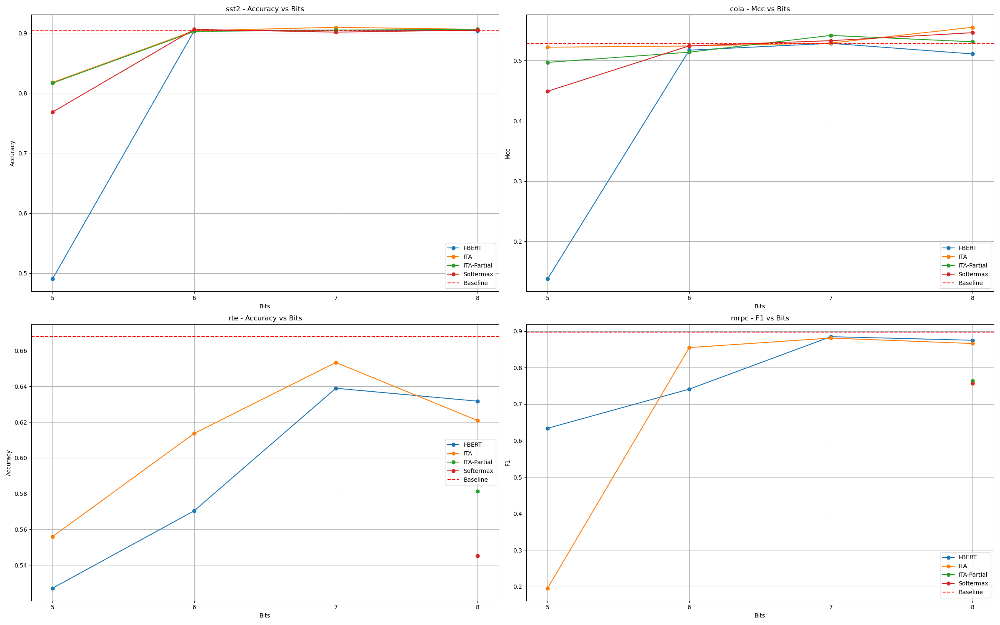
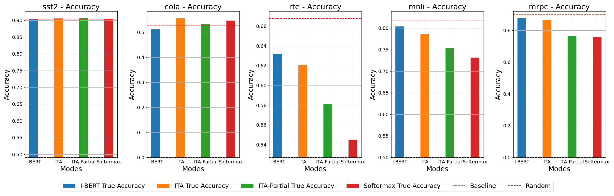

# Integer-only Softmax for Transformers

Semester project at the Integrated Systems Laboratory (IIS), ETH Zürich, 2024.

Softmax is the hardest part of a transformer to run on integer-only hardware: it needs an exponential, a sum and a division, and its inputs span a wide dynamic range. This project compares integer softmax approximations inside a fully integer-quantized MobileBERT and measures how far the bit width can be pushed before accuracy on GLUE collapses.



## What it compares

| Mode | Idea |
|---|---|
| **I-BERT** | Second-order polynomial approximation of `exp` ([Kim et al., 2021](https://arxiv.org/abs/2101.01321)) |
| **ITA** | Shift-based integer softmax from the Integer Transformer Accelerator |
| **ITA-Partial** | ITA variant that tracks the row maximum over partial blocks, as a streaming accelerator would |
| **Softermax** | Base-2 softmax with online normalisation ([Stevens et al., 2021](https://arxiv.org/abs/2103.09301)) |

Each mode is dropped into MobileBERT models fine-tuned on GLUE (SST-2, CoLA, RTE, MRPC, MNLI and others). The model is traced with `torch.fx`, activations are fake-quantized and fine-tuned with PACT, and the graph is then integerized so the evaluated model runs entirely in integer arithmetic.

## Findings

- **6 bits is enough on SST-2 and CoLA.** All four modes match the floating-point baseline from 6 bits up; at 8 bits ITA slightly exceeds it on CoLA.
- **ITA degrades most gracefully.** At 5 bits it keeps 82% accuracy on SST-2 and close to baseline MCC on CoLA, where I-BERT and Softermax lose much more.
- **Harder tasks separate the methods.** On RTE and MRPC, I-BERT and ITA stay within a few points of the baseline at 7–8 bits, while ITA-Partial and Softermax lose 10+ F1 points on MRPC.
- **4 bits is too few:** every mode drops to or near random-guess level.



Raw numbers for every run are in [`results/`](results/): bit-width sweep (`reduced_bitwidth`), bias shift of the attention scores (`bias_shift`), clipping percentiles (`percentile`) and activation variance (`variance`), each with the script that plots it.

## Code

| File | Role |
|---|---|
| `evaluate_model.py` | Entry point: loads a fine-tuned MobileBERT, quantizes, fine-tunes, integerizes and evaluates it on a GLUE task |
| `passes.py` | `torch.fx` passes that replace softmax with the approximations and integerize them |
| `fx.py` | Tracer for HuggingFace models, interpreters and activation-histogram plotting |
| `quantlib/` | Submodule: fork of the [quantlib](https://github.com/HanStaehlin/quantlib) quantization library with the softmax fixes |
| `legacy/` | Earlier experiments and helper modules |

## Running it

```bash
git clone --recursive https://github.com/HanStaehlin/SoftMaxEvaluation.git
cd SoftMaxEvaluation
pip install -r requirements.txt
python evaluate_model.py --config mobilebert_sst2 --bits 6
```

`--config` selects the GLUE task (`mobilebert_sst2`, `mobilebert_cola`, `mobilebert_rte`, `mobilebert_mrpc`, …) and `--bits` the activation bit width. The softmax mode (`Quantization_Mode`: `I-BERT`, `ITA`, `ITA-Partial`), clipping percentiles, number of fine-tuning epochs and output file are set at the top of `evaluate_model.py`. Results are appended to the file named there; histograms of the integerized activations go to `histograms_tq/` when plotting is enabled.
